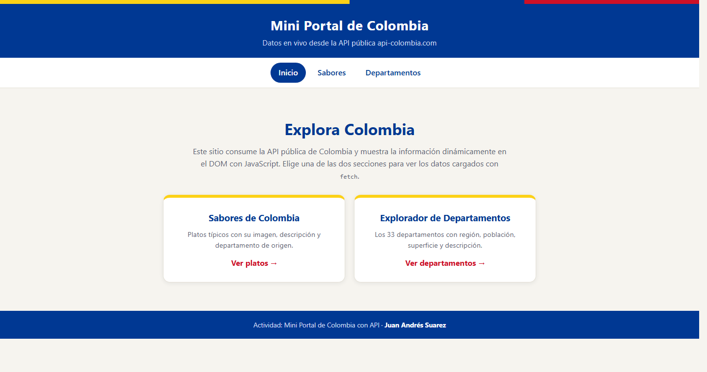
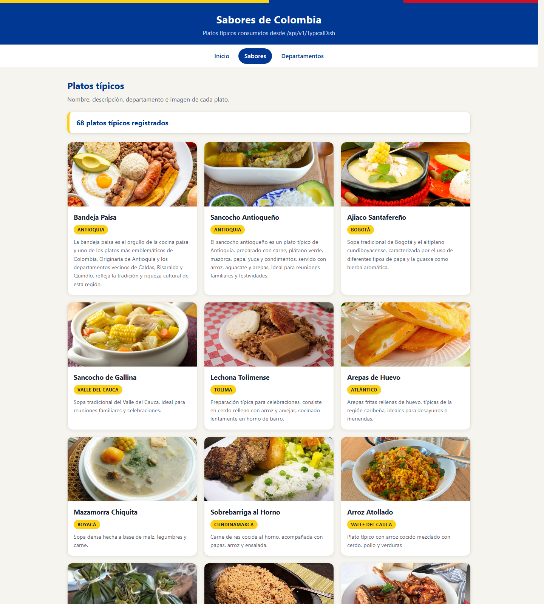
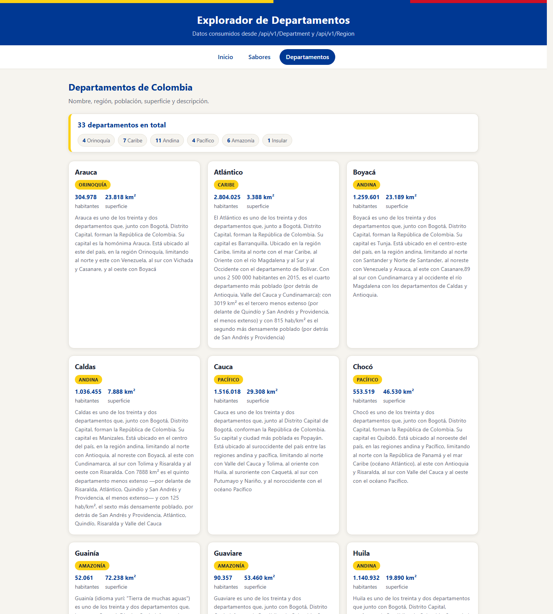

# Mini Portal de Colombia con API

**Estudiante:** Juan Andrés Suarez

## Descripción

Mini portal web que consume la API pública [api-colombia.com](https://api-colombia.com/)
y muestra la información dinámicamente en el DOM con JavaScript.

De las 5 opciones de la actividad se desarrollaron **2**, en páginas separadas
conectadas mediante hipervínculos:

1. **Sabores de Colombia** (`sabores.html`) — opción 5. Consume `/api/v1/TypicalDish`
   y muestra nombre, descripción, departamento e imagen de cada plato.
   *Extra:* cuenta el total de platos (68).
2. **Explorador de Departamentos** (`departamentos.html`) — opción 1. Consume
   `/api/v1/Department` y muestra nombre, región, población, superficie y descripción.
   *Extra:* cuenta los departamentos por región.

Ambas páginas muestran un mensaje de carga y manejan los errores con `catch`.

## Tecnologías usadas

- HTML5
- CSS3 (hoja de estilos separada, sin frameworks)
- JavaScript vanilla (`fetch`, promesas, manipulación del DOM con `createElement`)
- API pública `https://api-colombia.com/`

## Estructura del proyecto

```
JuanAndres-Suarez-api-colombia/
├── index.html            # Portada con enlaces a las dos secciones
├── sabores.html          # Opción 5: platos típicos
├── departamentos.html    # Opción 1: departamentos
├── css/
│   └── estilos.css       # Estilos compartidos
├── js/
│   ├── sabores.js        # fetch + DOM de platos
│   └── departamentos.js  # fetch + DOM de departamentos
├── img/
│   └── platos/           # 68 imágenes optimizadas (600 px, ~2.8 MB en total)
└── capturas/             # Capturas de pantalla
```

## Instrucciones de uso

1. Clona o descarga el repositorio.
2. Abre `index.html` en tu navegador (se requiere internet para consumir la API).
3. Usa los enlaces de la barra de navegación para ir a **Sabores** o **Departamentos**.
4. Los datos se cargan solos con `fetch`; verás el mensaje de carga y luego las tarjetas.

> También puedes servirlo con cualquier servidor estático o publicarlo en GitHub Pages;
> al ser HTML/CSS/JS puro, no necesita compilación ni dependencias.

## Capturas

| Portada | Sabores | Departamentos |
|---|---|---|
|  |  |  |

## Detalles técnicos

- **Regiones:** el listado `/Department` devuelve `region: null` (solo `regionId`),
  por eso `departamentos.js` consume también `/api/v1/Region` y cruza los datos por
  `regionId` para mostrar el nombre de la región y contar por región.
- **Imágenes:** la API sirve ~20.6 MB en fotos (varias de más de 1 MB) y tenía 3 rotas
  (Tamal Tolimense, Arroz de Lisa y Dulce de guayaba). Se descargaron y optimizaron las
  68 imágenes a 600 px de ancho (JPEG, ~2.8 MB en total) y se sirven desde `img/platos/`.
  Así la página carga rápido, no depende de enlaces caídos y cada imagen tiene un
  respaldo por si alguna llegara a fallar.
- **Carga y errores:** cada página muestra un mensaje de carga que se oculta al llegar
  los datos, y un mensaje de error visible si el `fetch` falla (`.catch`).

## Nombre del estudiante

Juan Andrés Suarez